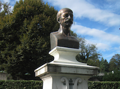

 

Mitte Januar 2016 wurde die Erschliessung des Nachlasses von Louis Niedermeyer (1802-1861), durch die Arbeitsstelle Schweiz des RISM im Dokumentationszentrum in Nyon abgeschlossen. Insgesamt bringt die Inventarisierung der handschriftlichen sowie gedruckten Musikquellen der Datenbank 315 neue Einträge.

Der Nachlass, der nahezu das gesamte Œuvre Niedermeyers in Form von Manuskripten und Drucken umfasst, ist überdies eine interessante Quelle im Hinblick auf die Verbreitung von Musik und das Musikeditionswesen im 19. Jahrhundert.

Mehr Informationen zur Katalogisierung in Nyon gibt es auf der [Projektseite](/cataloging/niedermeyer.html).

