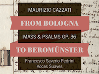

 

RISM Schweiz freut sich ausserordentlich, seine neue, mitproduzierte CD präsentieren zu können. Zu hören ist Maurizio Cazzatis Messa e Salmi, op. 36, das in einer Ersteinspielung vorliegt und von dem ein Frühdruck Ende des 17. Jahrhunderts im Stift Beromünster aufbewahrt wurde, welcher heute leider verschollen ist.

Es ist das Bestreben von RISM Schweiz – sowohl mittels der Datenbank als auch mit der vorliegenden CD – auf die unzähligen Schätze musikalischen Schaffens vergangener Jahrhunderte aufmerksam zu machen und Musikerinnen und Musiker zur Auseinandersetzung auch mit diesem Repertoire zu animieren. Das Werk wurde vom Ensemble [Voces Suaves](http://www.voces-suaves.ch/) unter der Leitung von [Francesco Saverio Pedrini](http://www.francescosaveriopedrini.com/) eingespielt. Die Aufnahme ist am 4. März beim Label Claves erschienen.

**Maurizio Cazzati: Messa Concertata à 5**  
<iframe width="420" height="315" src="https://www.youtube.com/embed/mrFGhDCMMRI" frameborder="0" allowfullscreen></iframe>

Mehr Informationen gibt es auf der [Projektseite](/cd-cazzati.html)

