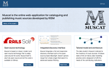

 

Jede RISM-Arbeitsgruppe kennt Muscat - es ist die vertraute Oberfläche, mit der jeder Mitarbeiter seit 2016 Musikquellen in der RISM-Datenbank katalogisiert. Aber was ist die Geschichte und die Philosophie dieses Softwareprojekts? Was sind seine technischen Komponenten? Was bietet es?

Tatsächlich wurde die Katalogisierungssoftware nicht ganz neu entwickelt, sondern vereint eine Reihe von Funktionen, die alle frei zugänglich sind, kombiniert sie und passt sie an die Bedürfnisse des RISM-Projekts an. Eine kürzlich aufgeschaltete Website bietet Einblicke in die Entwicklung und die verschiedenen Komponenten von Muscat: [**http://muscat-project.org**](http://muscat-project.org)

Muscat ist die von RISM entwickelte Online-Webanwendung zur Katalogisierung und Veröffentlichung von Musikquellen. Das Projekt wurde 2002 von der britischen RISM-Arbeitsgruppe initiiert und von RISM Schweiz weiterentwickelt. Seit Anfang 2014 kann Muscat – dank der Entscheidung von RISM Schweiz und RISM UK, die Anwendung auf Open-source-Basis zu erstellen – in Zusammenarbeit mit der RISM-Zentrale in Frankfurt weiterentwickelt werden. Mit der Migration des vollständigen RISM-Datensets im Jahr 2016 wurde Muscat der gesamten RISM-Community zur Verfügung gestellt.

Muscat weist unter anderem neun markante technische Merkmale auf:

- Es basiert auf Open-Source-Technologie. 
- Es integriert mehrere Suchoptionen in einer umfassenden Suchoberfläche. 
- Das Datenmodell ist auf die Bedürfnisse von RISM zugeschnitten und entspricht dem MARC-Standard.
- Muscat unterstützt eine integrierte Incipit-Anzeige und Incipit-Suche. 
- Benutzer können Kommentare und Feedback an die Community direkt aus Muscat senden. 
- Bilder können direkt oder über den Standard IIIF hochgeladen und in einem hochauflösenden Bildanzeigeprogramm angezeigt werden. 
- Muscat verfolgt alle Änderungen, die an den einzelnen Datensätzen in der Datenbank vorgenommen wurden. 
- Die Daten sind mit internationalen Autoritätsdateien, wie z.B. VIAF, verknüpft. 
- Schliesslich bietet Muscat eine dynamische Visualisierung der Suchergebnisse auf einer geographischen Karte.

