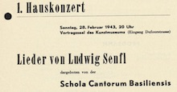

 

For its 75th anniversary (1942-2017), the association Freunde Alter Musik Basel decided to publish its concert programmes on the OnStage platform of RISM Schweiz. The almost complete collection of all concert and season programmes was digitised and indexed by date, composer and performer. In addition, a full-text search is possible

The collection comprises are more than 300 documents, for a total amount of ca. 3000 images. The indexing and digitisation took place in the Swiss National Library in 2016, the programmes are online since March 2017.

See the [project page](/infrastructure/onstage-famb.html) for more information about the project.

