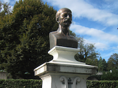

 

Le catalogage du fonds Louis Niedermeyer (1802-1861) dans le Centre de Documentation à Nyon a été achevé par le bureau suisse du RISM mi-janvier 2016. Le catalogage des sources manuscrites et imprimées correspond à 315 nouveaux titres dans notre base de données.

Ce fonds, réunissant quasiment l’ensemble de l’œuvre de Niedermeyer transmise sous forme de manuscrits et d’imprimés, est une source d’information particulièrement intéressante pour ce qui concerne la diffusion de la musique et les pratiques d’édition au 19ème siècle.

Pour plus d'informations à propos du projet à Nyon, veuillez consulter la [page du projet](/cataloging/niedermeyer.html).

