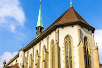

 

L’association du Bureau suisse du Répertoire International des Sources Musicales (RISM) célèbre le 14 juin 2016 son 20ème anniversaire avec un concert public. L’ensemble vocal de bâlois Voces Suaves exécutera un extrait de la «&nbsp;Messa e Salmi&nbsp;», op. 36 de Maurizio Cazzati. Un discours sur le thème «&nbsp;musique (culture) - politique – science&nbsp;» sera prononcé par l’ancienne conseillère aux Etats Christine Egerszegi-Obrist. Le concert à l’église française de Berne commencera à 19h 30. L’entrée est libre (collecte).

Pour le concert d’anniversaire le jeune ensemble vocal bâlois Voces Suaves sous la direction de Francesco Saverio Pedrini sera accompagné par l’ensemble instrumental Opera Prima. Les exécutions en formation de solistes de Voces Suaves se basent sur la connaissance du contexte historique de la musique de la Renaissance et de la musique baroque. Le répertoire comprend des madrigaux italiens, des œuvres du baroque allemand et également des oratorios et des messes italiennes. L’ensemble veille qu’à côté d’œuvres d’artistes renommés tels que Monteverdi et Schütz à chanter aussi des œuvres des compositeurs oubliés comme Domenico Sarro ou tout simplement Maurizio Cazzati. L’ensemble qui a été fondé en 2012 par Tobias Wicky consiste neuf chanteurs professionnels qui sont pour la plupart liés à la Schola Cantorum Basiliensis. Entre 2014-2016 Voces Suaves fait partie du programme de soutien européen eeemerging, Emerging European Ensembles Project qui favorise le développement de l’ensemble.

 La Messa e Salmi, op. 36 de Maurizio Cazzati a été enregistrée sous le titre «&nbsp;From Bologna to Beromünster&nbsp;» par Claves Records (CD 1605) en mars 2016. 

Ce projet est le fruit d’une collaboration entre le RISM Suisse et l’ensemble Voces Suaves. Le disque est disponible dans le commerce. Le RISM Suisse est une des groupes de travail officiels au sein de la communauté internationale du RISM et a comme but d’inventorier le plus grands nombre de sources musicales historiques et de les rendre ainsi accessible au public. Le bureau du RISM Suisse a son siège à Berne s’occupe de tous les documents qui se trouvent dans les bibliothèques, archives et monastère. Le RISM Suisse a été fondé en 1956. Depuis le 21 juin 1996, le RISM Suisse est une association indépendante soutenue par divers institutions scientifique et bibliothécaire comme la Société Suisse de Musicologie (SSM), l’association Suisse des Collections Musicales (ASCM), la coopérative des auteurs et éditeurs de musique (SUISA) et le conseil Suisse de la musique (CSM). Depuis sa fondation, le RISM a inventorié systématiquement plus de 50‘0000 partitions manuscrites datées depuis le 17ème siècle (un quart sont des manuscrits autographes), plus que 10’000 imprimés d'avant 1800, des collections d'imprimés du 16ème aux 18ème siècles et des traités musicaux ainsi que de 21’000 partitions imprimées du 19ème et 20ème siècle.

