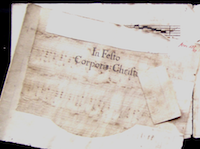

 

Le RISM Suisse de réjouit d’annoncer que la description complète des sources de la bibliothèque musicale historique du couvent des sœurs bénédictines de Saint-André à Sarnen est maintenant [accessible en ligne](http://www.rism-ch.org/catalog/?search_field=library_siglum&q=CH-SAf). Cette collection importante représente environ 10'000 titres qui sont désormais à disposition des chercheurs et des musiciens.

La mise en ligne de ces données clôt un projet important débuté en 2003. La crue historique d’août 2005 et l’inondation complète de la bibliothèque musicale du couvent qui en résulta ont causé un important retard. Le travail de catalogage n’a pu reprendre qu’après la déshydratation et le reclassement complet de tous les documents. Il a été effectué d’abord par le [personnel du RISM Suisse](/cataloging/sarnen.html) et à partir de 2010 par Dr [Gabriella Hanke Knaus](http://www.hankeknaus.ch).

Les sources peuvent maintenant être consultées sur rendez-vous dans la salle des visiteurs de la bibliothèque nouvellement créée. Pour les conditions d'utilisation, veuillez consulter le site [Internet](http://www.frauenkloster-sarnen.ch/musikbibliothek/) de la bibliothèque de musique.

