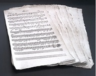

 

All'inizio di giugno 2015 è stato completato il catalogo della collezione di Fischingen nell'archivio di Stato a Frauenfeld. La catalogazione delle fonti manoscritte e a stampa ha apportato alla banca dati 1039 nuovi titoli.

Le fonti musicali del monastero di Fischingen sono databili tra il XVII e il principio del XIX secolo. La maggior parte risale al periodo 1760-1810. Presumibilmente si tratta della collezione in uso nel monastero subito prima della sua soppressione nel 1848. A favore di questa ipotesi è il luogo di ritrovamento della musica, un armadio barocco poco appariscente nel coro superiore della chiesa monastica.

La collezione musicale rappresenta probabilmente la parte più recente di una biblioteca musicale finora pressoché sconosciuta. Poiché non si trovano titoli musicali negli inventari della biblioteca del monastero, la collezione doveva conservarsi separata. Le fonti stampate suggeriscono inoltre uno scambio intenso con i monasteri di Einsiedeln, San Gallo (oggi St. Johann) e Kempten.

Si veda la [pagina del progetto](/cataloging/fischingen.html) per ulteriori informazioni sul progetto a Fischingen.

