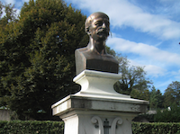

 

Alla metà di gennaio 2016 è stato completato il catalogo del fondo Louis Niedermeyer (1802-1861), conservato dall'Associazione Niedermeyer a Nyon.La catalogazione delle fonti manoscritte e a stampa ha apportato alla banca dati 315 nuovi titoli.

Il Fondo, che comprende la quasi integralità dell'opera di Niedermeyer in forma di manoscritti ed edizioni a stampa, è una fonte particolarmente interessante di informazioni per la trasmissione della musica e le pratiche dell'editoria musicale nel XIX secolo.

Si veda la [pagina del progetto](/cataloging/niedermeyer.html) per ulteriori informazioni sul progetto a Nyon.

