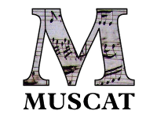

 

Dal 14 novembre, tutti i gruppi di lavoro RISM a livello internazionale stanno lavorando con il nostro software Muscat. La migrazione di tutti i dati RISM (circa 1 milione di titoli) è stata realizzata dalla Redazione centrale RISM (esportazione di dati da Kallisto) e dal nostro collaboratore Rodolfo Zitellini (importazione in Muscat).

Muscat è un software che sviluppiamo e utilizziamo presso RISM Svizzera dal 2008. È il frutto di una collaborazione con RISM Regno Unito e, dal 2014, con la Redazione centrale. I feedback che abbiamo ricevuto dagli utenti Muscat in tutto il mondo dopo circa un mese di lavoro sono estremamente positivi e con questa migrazione RISM ha fatto un passo in avanti molto importante.

Si veda la [pagina del progetto](/infrastructure/muscat.html) per ulteriori informazioni sul progetto.

