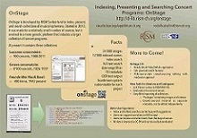

 

A ottobre, la piattaforma web "OnStage" è stata presentata da due collaboratori con un poster in un seminario presso la Biblioteca di Stato e Universitaria della Sassonia (SLUB). Lo scopo del seminario era di confrontare diverse soluzioni per lo sviluppo e l'accesso alle "pubblicazioni effimere di esecuzioni musicali" per discutere la realizzazione di un database comune. In un produttivo scambio con colleghi provenienti da Germania, Francia, Gran Bretagna e Australia, il nostro progetto ha convinto con la sua struttura semplice e chiara facilità d'uso.

"OnStage" è stato lanciato nel 2012 e attualmente comprende tre collezioni conservate a Losanna, Ginevra e Basilea. La piattaforma web è già stata presentata a due congressi IAML, nel 2016 a Roma e nel 2017 a Riga. Una nuova versione del software è in fase di pianificazione.

Si veda la [pagina web](http://d-lib.rism-ch.org/onstage/) per ulteriori informazioni.

