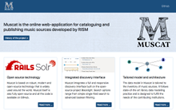

 

Ogni gruppo di lavoro RISM conosce Muscat - è l'interfaccia familiare con cui ogni collaboratore cataloga le fonti musicali nel database RISM dal 2016. Ma qual è la storia e la filosofia di questo progetto software? Quali sono i suoi elementi tecnici? Che cosa offre?

Il software di catalogazione, in realtà, non è stato sviluppato interamente da zero, ma riunisce una serie di componenti liberamente accessibili, combinandole e adattandole alle esigenze del progetto RISM. Un sito web dedicato, lanciato di recente, offre una panoramica sullo sviluppo e sulle diverse componenti di Muscat: [**http://muscat-project.org**](http://muscat-project.org)

Muscat è l'applicazione web online per la catalogazione e la pubblicazione di fonti musicali sviluppata da RISM. Il progetto è stato avviato nel 2002 dal gruppo di lavoro britannico di RISM e successivamente sviluppato dal RISM Svizzera. Dall'inizio del 2014, Muscat è stato sviluppato in collaborazione con l'ufficio centrale RISM di Francoforte grazie alla decisione del RISM-UK e del RISM Svizzera di renderlo open-source. Muscat è stato messo a disposizione dell'intera comunità RISM con la migrazione dell'intero insieme di dati RISM nel 2016.

Muscat presenta, tra l'altro, nove importanti caratteristiche tecniche.

- Si basa su tecnologia open source. 
- Integra diverse opzioni di ricerca in un'interfaccia di ricerca completa. 
- Il modello di dati è adattato alle esigenze di RISM ed è conforme allo standard MARC.
- Muscat supporta la visualizzazione di incipit e la ricerca per incipit integrata.- Gli utenti possono inviare commenti e feedback alla comunità direttamente da Muscat. 
- Le immagini possono essere caricate direttamente o tramite lo standard IIIF e appaiono in un visualizzatore di immagini ad alta risoluzione. 
- Muscat tiene traccia di tutte le modifiche apportate ai singoli record nel database. 
- I dati sono collegati a file di autorità internazionali, come VIAF. 
- Infine, Muscat fornisce una visualizzazione dinamica su una mappa geografica dei risultati della ricerca.

