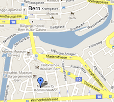

<h1>
    {{ site.data.contact.title[site.active_lang] }}
</h1>

    

        

            

                {{ site.data.contact.office.address[site.active_lang] }}
                  
                <a href="mailto:{{ site.data.contact.office.email }}"><i class="fas fa-envelope"></i>mailto:{{ site.data.contact.office.email }}</a>
            

            

                {{ site.data.contact.office.howto[site.active_lang] }}
            

            

                {{ site.data.contact.office.nb[site.active_lang] }}
            

        

        

            

                
            

        

    
  
    
    <h4>
        {{ g.labels[site.active_lang] }}
    </h4>
        
        

            {{ p.name }}
        

        

            
            {{ p.days[site.active_lang] }}
            
             
            <a href="mailto:{{ p.email }}"><i class="fas fa-envelope"></i>{{ p.email }}</a>
        

        

        	<a href="#{{ p.id }}" data-action="collapse">
                <i class="fas fa-plus"></i>
            </a>
        

        

            

                

                    

                        {{ p.text[site.active_lang] }}
                    

                

                

                    
                    
                    
                

            

         

         

        
    

