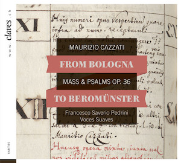

# From Bologna to Beromünster -- Cazzati: Messa e Salmi, op. 36

    
    

        <a href="http://docs.rism-ch.org/press/CD_1605_booklet.pdf" target="_blank">Download Booklet (PDF)</a> 
    

In der Musikbibliothek des Stifts Beromünster befindet sich der
sogenannte Bonus Ordo Musicus, ein handschriftliches Inventar aus dem
Jahr 1696, das die heute weitgehend verlorene Musikaliensammlung von
damals auflistet. Die Arbeitsstelle Schweiz des RISM hat dieses, nebst
anderen Inventaren, in einem separaten Projekt digitalisiert, indexiert
und schließlich online publiziert ([Historical Music Inventories
1500-1800]). Darin aufgeführt ist auch ein Druck der Messa e Salmi, op.
36 von Maurizio Cazzati (1616-1678), der seinerzeit als Maestro der
Basilika San Petronio in Bologna eine herausragende Stelle innerhalb des
Musiklebens der Stadt einnahm.

RISM Schweiz erhielt zu seinem 20jährigen Vereinsjubiläum von 2016 --
und dem 400. Geburtstag des Komponisten -- die Gelegenheit, in
Kooperation mit dem Label [Claves Records]{:target="_blank"} und dem jungen Basler
Ensemble [Voces Suaves]{:target="_blank"} eine CD mit ebendiesem Werk zu produzieren.
Dabei haben die RISM-Mitarbeiter das Projekt während den Aufnahmen
beratend begleitet, die Texte für das Booklet erstellt sowie
organisatorische und administrative Aufgaben übernommen. Schließlich hat
der Verein das Projekt mit einem namhaften Beitrag unterstützt. Die CD
ist seit dem 4. März 2016 im Handel, auch als Download, erhältlich.



#### Zeitungsartikel



[Historical Music Inventories 1500-1800]: http://inventories.rism-ch.org/
[Claves Records]: http://www.claves.ch/collections/all-albums/products/from-bologna-to-beromunster-maurizio-cazzati-mass-psalms-op-36
[Voces Suaves]: http://www.voces-suaves.ch/
