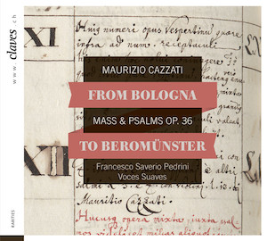

# From Bologna to Beromünster -- Cazzati: Messa e Salmi, op. 36

    
    

        <a href="http://docs.rism-ch.org/press/CD_1605_booklet.pdf" target="_blank">Download CD booklet (PDF)</a> 
    

The music library of Beromünster Collegiate church (CH-BM) houses the
Bonus Ordo Musicus, a handwritten inventory from 1696 which lists a
music collection from the time that is largely lost today. In a separate
project, [Historical Music Inventories 1500-1800], RISM Switzerland
digitized, indexed, and published online this and other inventories. The
inventory registers a printed edition of Messa e Salmi, op. 36, by
Maurizio Cazzati (1616-1678), who in his time as Maestro of the Basilica
San Petronio in Bologna held a distinguished position within the musical
life of the city.

On the occasion of the 20th anniversary of the RISM Switzerland
Association -- and the 400th birthday of Cazzati -- RISM Switzerland had
the opportunity to produce a CD of this work in cooperation with the
music label [Claves Records]{:target="_blank"} and the Basel ensemble 
[Voces Suaves]{:target="_blank"}. RISM
staff played an advisory role while the CD was being recorded and they
also wrote texts for the booklet. In addition, they assumed some
organizational and administrative tasks and the Association also made a
considerable financial contribution to the project. The CD was released
on 4 March 2016 and is available in stores and to download online.



#### Press articles



[Historical Music Inventories 1500-1800]: http://inventories.rism-ch.org/
[Claves Records]: http://www.claves.ch/collections/all-albums/products/from-bologna-to-beromunster-maurizio-cazzati-mass-psalms-op-36
[Voces Suaves]: http://www.voces-suaves.ch/
