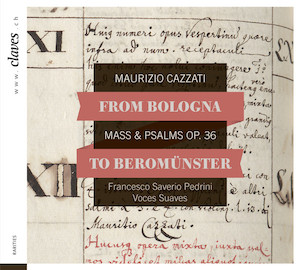

# From Bologna to Beromünster -- Cazzati: Messa e Salmi, op. 36

    
    

        <a href="/resources/press/CD_1605_booklet.pdf" target="_blank">Libretto del CD da scaricare (PDF)</a> 
    

La biblioteca musicale della Collegiata di Beromünster (CH-BM) ospita il
Bonus Ordo Musicus, un inventario manoscritto del 1696 che descrive una
collezione musicale dell'epoca che è oggi in gran parte perduta. In un
progetto precedente, [Historical Music Inventories 1500-1800], RISM
Svizzera ha digitalizzato, indicizzato e pubblicato online questo e
altri inventari. L'inventario riporta un esemplare dell'edizione
stampata della Messa e Salmi, op. 36, di Maurizio Cazzati (1616-1678),
che come maestro di cappella della Basilica di San Petronio a Bologna
ricopriva all'epoca una posizione importante all'interno della vita
musicale della città.

In occasione del XX anniversario dell'Associazione RISM Svizzera -- e
del 400° anniversario di Cazzati -- RISM Svizzera ha avuto l'opportunità
di produrre un CD di quest'opera in collaborazione con l'etichetta
musicale [Claves Records]{:target="_blank"} e l'ensemble di Basilea 
[Voces Suaves]{:target="_blank"}. Il
personale RISM ha svolto un ruolo di consulenza durante la registrazione
del CD e ha anche scritto testi per il libretto. Inoltre, ha assunto
alcuni compiti organizzativi e amministrativi e l'Associazione ha anche
contribuito finanziariamente al progetto. Il CD è stato pubblicato il 4
marzo 2016 ed è disponibile nei negozi e da scaricare on-line.



#### Articoli della stampa



[Historical Music Inventories 1500-1800]: http://inventories.rism-ch.org/
[Claves Records]: http://www.claves.ch/collections/all-albums/products/from-bologna-to-beromunster-maurizio-cazzati-mass-psalms-op-36
[Voces Suaves]: http://www.voces-suaves.ch/
