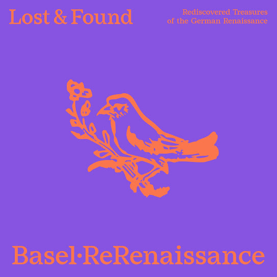

# Lost & Found

    

Das Basler Forum für alte Musik [ReRenaissance](https://www.rerenaissance.ch/) hat im Dezember 2025 das Album [*Lost & Found: Rediscovered Treasures of the German Renaissance*](https://music.imusician.pro/a/ZJmUclkS) veröffentlicht, das in Zusammenarbeit mit dem RISM Digital Center entstanden ist. Es handelt sich um die Erstaufnahme von neun Kompositionen aus dem frühen 16. Jahrhundert, die lange Zeit als unvollständig galten. Das RISM Digital Center fördert seit langem [Aufnahmen](https://rism.digital/de/rism-ch/cds.html), die Schweizer Musikleben und -sammlungen vorstellen. Erneut hat es sich mit einer Gruppe zusammengetan für eine neue Aufnahme, die einen bedeutenden Fund in der Schweizerischen Nationalbibliothek präsentiert. Einige Jahre nach dem Erscheinen der [letzten CD](https://rism.digital/de/rism-ch/cds/cd-marenzio.html) beteiligt sich damit das RISM Digital Center wieder an ein Aufnahmeprojekt. 
1898 kamen die zwei Tenor-Stimmbücher der 68 dreistimmigen [*Cantiones selectissimae*](https://rism.online/sources/993114959) und der 43 vierstimmigen [*Cantiones*](https://rism.online/sources/993114957), beide 1536 in Frankfurt von Christian Egenolff herausgegeben, in die Schweizerische Nationalbibliothek. Die zwei nur acht auf elf Zentimeter grosse Bücher sind zusammen gebunden und tragen die Signatur [Ma 3549](https://www.helveticat.ch/permalink/41SNL_51_INST/1juain7/alma991014413859703976). Die [Bibliothek](https://www.nb.admin.ch/snl/de/home/ueber-uns/geschichte.html) war erst drei Jahre zuvor gegründet worden, und die zwei Musikdrucke waren Teil des Nachlasses ihres Initianten [Friedrich Staub]( https://hls-dhs-dss.ch/de/articles/011689/2024-11-11/). Vielleicht gerade weil es sich nicht um Schweizer Bücher handelte, blieben die zwei Musikdrucke lange unbeachtet. Erst 2018 wies Royston Gustavson in seinem bibliographischen Katalog der Egenolff-Drucke auf die zwei Stimmbücher hin, die dann 2019 von David Fallows musikwissenschaftlich eingehend besprochen wurden. 
Egenolff war im 16. Jahrhundert einer der bedeutendsten Verlegern in Frankfurt, nicht nur für Musik. Die Lieder in seinen erfolgreichen Sammlungen wählte er anscheinend selber aus. Wie es für Ausgaben in Stimmbücher oft der Fall ist, sind von vielen seiner Drucke nicht sämtliche Stimmen erhalten: Von den beiden besprochenen Liedersammlungen sind heute nur die Tenorstimme in Bern und die Discantstimme in Paris erhalten ([F-Pn RES VM7-504](https://gallica.bnf.fr/ark:/12148/btv1b550064366), dort zusammengebunden mit einem dritten Egenolff-Druck). Ausserdem existiert eine zeitgenössische Abschrift der Basspartie von 31 der dreistimmigen Lieder in Heilbronn ([D-HBa MS X/2](https://www.diamm.ac.uk/sources/1808)).  
In der Tonkunst der Renaissance war satztechnisch der Tenor die wichtigste Stimme. Diese Tatsache widerspiegelt sich auch in den Drucken von Christian Egenolff. Ein ausführliches Titelblatt gibt es nämlich nur in der Tenorstimme, und nur dort sind die Namen der Komponisten am Anfang des jeweiligen Liedes aufgeführt. Drei Stücke galten vor der Wiederentdeckung der Tenorstimme als anonym, eben weil sie nur aus der Discantstimme der Egenolff-Sammlung bekannt waren: Die Vertonung der Chanson *Mille regretz* (Nr. 5 in der Sammlung zu vier Stimmen) soll von Heinrich Isaac stammen, Fallows nennt möglicherweise Josquin als Autor; *Damoiselle* (Nr. 38 in der gleichen Sammlung) und *Il tient à vous* (Nr. 60 der dreistimmigen Lieder) sind hingegen glaubwürdig Antoine de Févin und Alexander Agricola zugeschrieben. Komplizierter wird es, wenn andere Quellen für die gleichen Werke unterschiedliche Komponisten nennen. *Comment* (Nr. 50 zu drei Stimmen) wird Josquin zugeschrieben, doch stammt das Stück von Isaac. Die vierstimmige Chanson *Fors seulement* (Nr. 31 in der Sammlung) ist nicht von Pierre de la Rue, sondern von Mathieu Pipelare. Umgekehrt ist die Zuschreibung an Josquin von *Au bois au bois* (Nr. 6 zu vier Stimmen) wahrscheinlicher als die anderswo bezeugte an Pierre Moulu. 
Egenolffs *Cantiones selectissimae* war überhaupt die erste in Deutschland gedruckte Sammlung für drei Stimmen, denn damals war Vierstimmigkeit beliebt. Die meisten Lieder sind auch aus anderen Sammlungen bekannt, doch nicht alle. Die Mitglieder des in Basel basierten Forum für alte Musik [ReRenaissance](https://www.rerenaissance.ch/) sind auf die Musik des Spätmittelalters und der frühen Neuzeit spezialisiert. Auf ihrem Album [*Lost & Found*](https://music.imusician.pro/a/ZJmUclkS) sind die Ersteinspielungen der neun dreistimmigen Kompositionen zu hören, die dank der Wiederentdeckung der Tenorstimme in Bern nun zum ersten Mal vollständig rekonstruiert werden können. Die Lieder weisen in der Vorlage von 1536 keinen Text auf. In der Sammlung mit den vierstimmigen Liedern wird dafür eine bunte Palette an Klangfarben dadurch suggeriert, dass Holzschnitte mit Musikinstrumente abgebildet sind: Violine, Dudelsack, Drehleier und Laute. Auf dem Album sind dementsprechend die Lieder in abwechlungsreicher, variabler Formation aufgeführt: Je nach Tonsatz und Gefühlstimmung kommen Streicher, Bläser, Zupfinstrumente und stellenweise auch Gesang zum Zuge.
