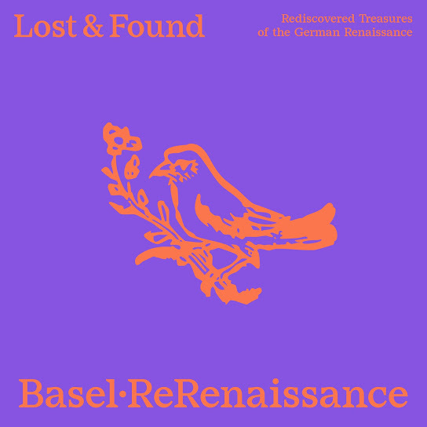

# Lost & Found

    

In December 2025, the Basel Forum for Early Music [ReRenaissance](https://www.rerenaissance.ch/) released the album [*Lost & Found: Rediscovered Treasures of the German Renaissance*](https://music.imusician.pro/a/ZJmUclkS), produced in collaboration with the RISM Digital Center. This is the first recording of nine compositions from the early 16th century that were long considered incomplete. The RISM Digital Center has a history of [sponsoring recordings](https://rism.digital/rism-ch/cds.html) that highlight Swiss musical life and collections. It is once again partnering with a group on a new recording highlighting an important discovery in the Swiss National Library. 
In 1898, the two tenor parts of the 68 three-part [*Cantiones selectissimae*](https://rism.online/sources/993114959) and the 43 four-part [*Cantiones*] (https://rism.online/sources/993114957), both published in Frankfurt in 1536 by Christian Egenolff, arrived at the Swiss National Library. The two books, measuring only eight by eleven centimetres, are bound together and bear the signature [Ma 3549](https://www.helveticat.ch/permalink/41SNL_51_INST/1juain7/alma991014413859703976). The [library](https://www.nb.admin.ch/snl/en/home/about-us/history.html) had been founded only three years earlier, and the two music prints were part of the estate of its initiator, [Friedrich Staub](https://hls-dhs-dss.ch/de/articles/011689/2024-11-11/). Perhaps precisely because they were not Swiss books, the two music prints remained unnoticed for a long time. It was not until 2018 that Royston Gustavson referred to the two part books in his bibliographic catalogue of Egenolff prints, which were then discussed in detail by musicologist David Fallows in 2019. 
Egenolff was one of the most important publishers in Frankfurt in the 16th century, not only for music. He apparently selected the songs in his successful collections himself. As is often the case with editions printed in partbooks, not all of the parts have been preserved for many of his prints: Of the two song collections discussed, only the tenor part in Bern and the descant part in Paris ([F-Pn RES VM7-504](https://gallica.bnf.fr/ark:/12148/btv1b550064366), bound together there with a third Egenolff print) have survived. In addition, there is a contemporary copy of the bass part of 31 of the three-part songs in Heilbronn ([D-HBa MS X/2](https://www.diamm.ac.uk/sources/1808)). 
In Renaissance music, the tenor was the most important voice from a compositional point of view. This fact is also reflected in Christian Egenolff's publications. Indeed, only the tenor part has a detailed title page, and the names of the composers are only indicated here, at the beginning of each piece. Before the rediscovery of the tenor voice, three pieces were considered anonymous, precisely because they were only known in the discantus part of Egenolff's collection: this version of the song *Mille regretz* (No. 5 in the four-part collection) is attributed to Heinrich Isaac, while Fallows suggests Josquin as a possible author; *Damoiselle* (No. 38 in the same collection) and *Il tient à vous* (No. 60 of the three-part pieces) are on the other hand reliably attributed to Antoine de Févin and Alexander Agricola. The question becomes more complicated when other sources cite different composers for the same works. *Comment* (No. 50 for three voices) is attributed to Josquin, but the piece is by Isaac. The four-part song *Fors seulement* (No. 31 in the collection) is not by Pierre de la Rue, but by Mathieu Pipelare. Conversely, the attribution of *Au bois au bois* (No. 6 for four voices) to Josquin is more likely than that to Pierre Moulu, which is attested elsewhere. 
Egenolff's *Cantiones selectissimae* was the first collection for three voices ever printed in Germany, as four-part harmony was popular at the time. Most of the songs are also known from other collections, but not all of them. The members of the Basel-based Forum for Early Music [ReRenaissance](https://www.rerenaissance.ch/) specialise in music from the late Middle Ages and early modern period. Their album [*Lost & Found*](https://music.imusician.pro/a/ZJmUclkS) features the first recordings of the nine three-part compositions that have now been fully reconstructed for the first time thanks to the rediscovery of the tenor part in Bern. The songs in the 1536 original editions do not have any lyrics. In the collection of four-part songs, however, a colourful palette of timbres is suggested by woodcuts depicting musical instruments: violin, bagpipes, hurdy-gurdy and lute. On the album, the songs are performed in a varied and flexible formation: depending on the composition and mood, strings, wind instruments, plucked instruments and, in some places, voices are used.

