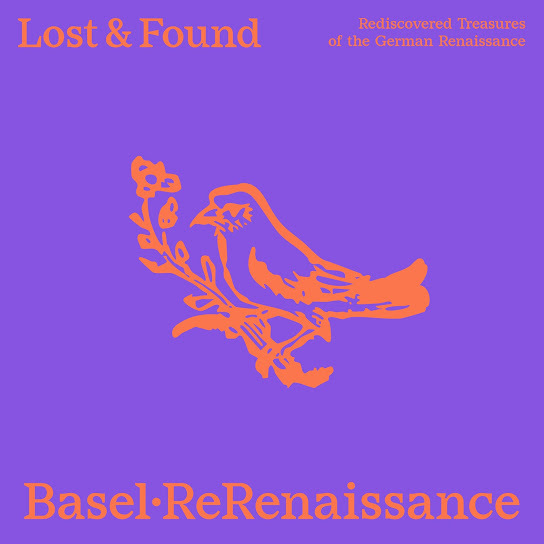

# Lost & Found

    

L’association bâloise pour la musique ancienne [ReRenaissance](https://www.rerenaissance.ch/) a publié en décembre 2025 l'album [*Lost & Found: Rediscovered Treasures of the German Renaissance*](https://music.imusician.pro/a/ZJmUclkS), réalisé en collaboration avec le RISM Digital Center. Il s'agit du premier enregistrement de neuf compositions du début du XVIe siècle, longtemps considérées comme incomplètes. Le RISM Digital Center sponsorise depuis longtemps des [enregistrements](https://rism.digital/fr/rism-ch/cds.html) qui mettent en valeur la vie musicale et les collections suisses. Il s'est ainsi associé à un groupe pour un nouvel enregistrement qui met en lumière une découverte importante à la Bibliothèque nationale suisse. 
En 1898, les deux recueils pour ténor des 68 [*Cantiones selectissimae*](https://rism.online/sources/993114959) à trois voix et des 43 [*Cantiones*] (https://rism.online/sources/993114957) à quatre voix, tous deux publiés en 1536 à Francfort par Christian Egenolff, sont entrés à la Bibliothèque nationale suisse. Les deux livres, qui ne mesurent que huit centimètres sur onze, sont reliés ensemble et portent la cote [Ma 3549](https://www.helveticat.ch/permalink/41SNL_51_INST/1juain7/alma991014413859703976). La [bibliothèque](https://www.nb.admin.ch/snl/fr/home/portrait/histoire.html) n'avait été fondée que trois ans auparavant, et les deux imprimés musicaux faisaient partie de la succession de son initiateur, [Friedrich Staub](https://hls-dhs-dss.ch/de/articles/011689/2024-11-11/). C'est peut-être précisément parce qu'il ne s'agissait pas de livres suisses que ces deux partitions sont longtemps restées ignorées. Ce n'est qu'en 2018 que Royston Gustavson a mentionné les deux livres de partitions dans son catalogue bibliographique des imprimés Egenolff, qui ont ensuite fait l'objet d'une analyse musicologique approfondie par David Fallows en 2019. 
Au 16ème siècle, Egenolff était l'un des éditeurs les plus importants de Francfort, et pas seulement dans le domaine musical. Il semble avoir sélectionné lui-même les chansons de ses recueils très populaires. Comme c'est souvent le cas pour les éditions en parties détachées, toutes les parties de nombre de ses imprimés n'ont pas été conservées : des deux recueils mentionnés, seules la partie du ténor à Berne et la partie du *discantus* à Paris ont été conservées ([F-Pn RES VM7-504](https://gallica.bnf.fr/ark:/12148/btv1b550064366), où elles sont reliées avec un troisième recueil imprimé par Egenolff). Il existe en outre une copie manuscrite contemporaine de la partie de basse de 31 des morceaux à trois voix à Heilbronn ([D-HBa MS X/2](https://www.diamm.ac.uk/sources/1808)). 
Dans la musique de la Renaissance, le ténor était la voix la plus importante du point de vue compositionnel. Ce fait se reflète également dans les publications de Christian Egenolff. En effet, seule la partie du ténor présente une page de titre détaillée et les noms des compositeurs ne sont indiqués qu'ici, au début de chaque morceau. Avant la redécouverte de la voix du ténor, trois morceaux étaient considérés comme anonymes, précisément parce qu'ils n'étaient connus que dans la partie de *discantus* du recueil d'Egenolff : cette version de la chanson *Mille regretz* (n° 5 dans le recueil à quatre voix) est attribuée à Heinrich Isaac, tandis que Fallows indique Josquin comme auteur possible ; *Damoiselle* (n° 38 dans le même recueil) et *Il tient à vous* (n° 60 des morceaux à trois voix) sont en revanche attribués de manière fiable à Antoine de Févin et Alexander Agricola. La question se complique lorsque d'autres sources citent des compositeurs différents pour les mêmes œuvres. *Comment* (n° 50 à trois voix) est attribuée à Josquin, mais le morceau est d'Isaac. La chanson à quatre voix *Fors seulement* (n° 31 dans le recueil) n'est pas de Pierre de la Rue, mais de Mathieu Pipelare. En revanche, l'attribution à Josquin de *Au bois au bois* (n° 6 à quatre voix) est plus probable que celle à Pierre Moulu attestée ailleurs. 
Les *Cantiones selectissimae* d'Egenolff ont été le premier recueil pour trois voix jamais imprimé en Allemagne, l'harmonie à quatre voix étant alors en vogue. La plupart des chansons sont également connues par d'autres recueils, mais pas toutes. Les membres de l’association bâloise [ReRenaissance](https://www.rerenaissance.ch/) sont spécialisés dans la musique de la fin du Moyen Âge et du début de l'époque moderne. Leur album [*Lost & Found*](https://music.imusician.pro/a/ZJmUclkS) présente les premiers enregistrements des neuf compositions à trois voix qui ont été entièrement reconstituées pour la première fois grâce à la redécouverte de la partie ténor à Berne. Les chansons des recueils originaux de 1536 ne contiennent pas de paroles. Dans le recueil de chants à quatre voix, cependant, une palette colorée de timbres est suggérée par des gravures sur bois représentant des instruments de musique : violon, cornemuse, vielle à roue et luth. Dans l’album, les chants sont interprétés dans une formation variée et flexible : selon la composition et son atmosphère, des cordes, des instruments à vent, des cordes pincées et, à certains endroits, des voix sont utilisés.

