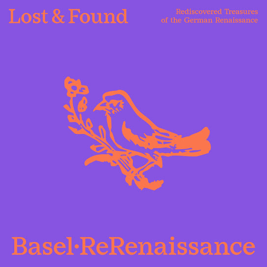

# Lost & Found

    

Nel dicembre 2025 l'ensemble basilese [ReRenaissance](https://www.rerenaissance.ch/) ha pubblicato l'album [*Lost & Found: Rediscovered Treasures of the German Renaissance*](https://music.imusician.pro/a/ZJmUclkS), realizzato in collaborazione con il RISM Digital Center. Si tratta della prima registrazione di nove composizioni del primo Cinquecento, a lungo considerate incomplete. Il RISM Digital Center sponsorizza da tempo [registrazioni](https://rism.digital/it/rism-ch/cds.html) che mettono in risalto la vita musicale e le collezioni svizzere. È tornato così a collaborare con un gruppo per una nuova registrazione che mette in risalto un'importante scoperta nella Biblioteca nazionale svizzera. 
Nel 1898 i due libri-parte per il tenore delle 68 [*Cantiones selectissimae*](https://rism.online/sources/993114959) a tre voci e delle 43 [*Cantiones*](https://rism.online/sources/993114957) a quattro voci, entrambi pubblicati nel 1536 a Francoforte da Christian Egenolff, entrarono a far parte della Biblioteca nazionale svizzera. I due libri, che misurano solo otto centimetri per undici, sono rilegati insieme e recano la sigla [Ma 3549](https://www.helveticat.ch/permalink/41SNL_51_INST/1juain7/alma991014413859703976). La [Biblioteca](https://www.nb.admin.ch/snl/it/home/chi-siamo/storia.html) era stata fondata solo tre anni prima e le due stampe musicali facevano parte del lascito del suo fondatore [Friedrich Staub](https://hls-dhs-dss.ch/de/articles/011689/2024-11-11/). Forse proprio perché non si trattava di libri svizzeri, le due stampe musicali rimasero a lungo ignorate. Solo nel 2018 Royston Gustavson, nel suo catalogo bibliografico delle stampe di Egenolff, segnalò i due libri-parte, che furono poi oggetto di un'approfondita analisi musicologica da parte di David Fallows nel 2019. 
Egenolff fu uno dei più importanti editori cinquecenteschi a Francoforte, e non solo nel campo musicale. Sembra che fosse lui stesso a selezionare i brani delle sue raccolte molto popolari. Come spesso accade per le edizioni in parti separate, non tutte le parti delle sue pubblicazioni si sono conservate: delle due raccolte citate, sono rimaste solo la parte del tenore a Berna e quella del *discantus* a Parigi ([F-Pn RES VM7-504](https://gallica.bnf.fr/ark:/12148/btv1b550064366), dove sono rilegate insieme a una terza raccolta stampata da Egenolff). Esiste inoltre una copia manoscritta contemporanea della parte del basso di 31 brani a tre voci a Heilbronn ([D-HBa MS X/2](https://www.diamm.ac.uk/sources/1808)). 
Nella musica rinascimentale, il tenore era la voce più importante dal punto di vista compositivo. Questo fatto si riflette anche nelle stampe di Christian Egenolff. Infatti, solo la parte del tenore presenta un frontespizio dettagliato e solo lì sono riportati i nomi dei compositori all'inizio di ogni brano. Prima della riscoperta della voce del tenore, tre brani erano considerati anonimi, proprio perché erano noti solo dalla parte di discanto della raccolta di Egenolff: questa versione della chanson *Mille regretz* (n. 5 nella raccolta a quattro voci) è attribuita a Heinrich Isaac, mentre Fallows indica come possibile autore Josquin; *Damoiselle* (n. 38 nella stessa raccolta) e *Il tient à vous* (n. 60 dei brani a tre voci) sono invece ascritti attendibilmente ad Antoine de Févin e Alexander Agricola. La questione si complica quando altre fonti citano compositori diversi per le stesse opere. *Comment* (n. 50 a tre voci) è attribuito a Josquin, ma il brano è di Isaac. La chanson a quattro voci *Fors seulement* (n. 31 nella raccolta) non è di Pierre de la Rue, ma di Mathieu Pipelare. Al contrario, l'attribuzione a Josquin di *Au bois au bois* (n. 6 a quattro voci) è più probabile di quella a Pierre Moulu attestata altrove. 
Le *Cantiones selectissimae* di Egenolff furono la prima raccolta a tre voci mai stampata in Germania, essendo allora più diffusa l'armonia a quattro voci. La maggior parte delle canzoni sono note anche in altre raccolte, ma non tutte. I membri dell’associazione basilese [ReRenaissance](https://www.rerenaissance.ch/) sono specializzati nella musica del tardo Medioevo e dell'inizio dell'età moderna. Il loro album [*Lost & Found*](https://music.imusician.pro/a/ZJmUclkS) presenta le prime registrazioni delle nove composizioni a tre voci che sono state interamente ricostruite per la prima volta grazie alla riscoperta della parte del tenore a Berna. Le canzoni delle raccolte originali del 1536 non contengono testi. Nella raccolta di canti a quattro voci, tuttavia, una tavolozza colorata di timbri è suggerita da incisioni su legno che raffigurano strumenti musicali: violino, cornamusa, ghironda e liuto. Sull’album, i canti sono interpretati con una formazione varia e flessibile: a seconda della composizione e dell'atmosfera, vengono utilizzati archi, fiati, strumenti a pizzico e, in alcuni casi, voci.

