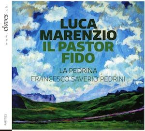

# Il Pasto Fido -- Luca Marenzio

    
    

        <a href="/resources/press/CD_1814_booklet.pdf" target="_blank">Download CD booklet (PDF)</a> 
    

    

In the archive of the Swiss municipality of Zuoz, in Engadin, a very
precious music book has been preserved. With the support of the RISM
Switzerland, the director Francesco Saverio Pedrini and his ensemble [La
Pedrina]{:target="_blank"} chose to record a selection from this collection with the
[Claves]{:target="_blank"} label. The choice made was for madrigals by the Italian
Renaissance composer, Luca Marenzio. The recording was scientifically
accompanied by the [Marenzio Project]{:target="_blank"}, based in the USA. The
[CD][Claves]{:target="_blank"} contains all the musical settings by Marenzio of texts from
Battista Guarini's pastoral comedy Il pastor fido.

The Zuoz collection consists of both French psalm settings, and Italian
Renaissance madrigals by Claudio Monteverdi (1567-1643) and Luca
Marenzio (1554-1599). Balthasar Planta (1685-1764) from Zuoz acquired
this collection in 1707 during his military service in Amsterdam. The
individual prints originate particularly from northern Europe, including
Haarlem, Amsterdam and Antwerp. Among these is a collection printed and
published in Antwerp in 1632 by the heirs of Pierre Phalèse (1510-1573)
with five-part madrigals by Marenzio. This edition is valuable in two
respects. Firstly, Phalèse added a basso continuo to Marenzio\'s purely
vocal compositions; secondly, the collection in Zuoz is currently the
only known copy of this edition. The inclusion of a basso continuo
group, as foreseen in the source of 1632, makes the project unique. The
CD has been available since July 2018.



#### Press articles



[La Pedrina]: https://www.lapedrina.ch/
[Claves]: https://www.claves.ch/collections/rarities/products/luca-marenzio-il-pastor-fido
[Marenzio Project]: http://www.marenzio.org/
