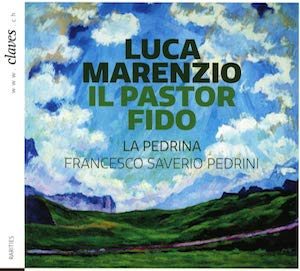

# Il Pasto Fido -- Luca Marenzio

    
    

        <a href="http://docs.rism-ch.org/press/CD_1814_booklet.pdf" target="_blank">Télécharger le livret du CD (PDF)</a> 
    

    

Dans les archives de la commune suisse de Zuoz, en Engadine, est
conservé un recueil de musique d'une importance particulière. Avec le
soutien du RISM Suisse, le directeur Francesco Saverio Pedrini et son
ensemble [La Pedrina]{:target="_blank"} ont choisi d\'enregistrer un extrait de cette
collection avec le label [Claves]{:target="_blank"}. Le choix s\'est porté sur les
madrigaux du compositeur italien de la Renaissance Luca Marenzio
(1554-1599). L\'enregistrement a été accompagné scientifiquement par le
[projet Marenzio]{:target="_blank"}, basé aux Etats-Unis. Le [CD][Claves]{:target="_blank"} contient des
mises en musique par Marenzio des textes de la comédie pastorale Il
pastor fido de Battista Guarini.

La collection de Zuoz se compose d\'une part de psaumes en français et
de l\'autre de madrigaux italiens de la Renaissance de Claudio
Monteverdi (1567-1643) et Luca Marenzio (1554-1599). Balthasar Planta
(1685-1764), résidant à Zuoz, acquiert cette collection en 1707 lors de
son service militaire à Amsterdam. L\'origine des éditions qu\'elle
contient est centrée sur l'Europe du Nord, notamment à Haarlem,
Amsterdam et Anvers. Parmi elles se trouve la collection imprimée et
publiée à Anvers en 1632 par les héritiers de Pierre Phalèse (1510-1573)
d\'un choix de madrigaux à cinq voix de Marenzio. Cette édition est
précieuse à deux égards. D\'une part, Phalèse a ajouté, dans cette
édition, une basse continue aux compositions de Marenzio, à l\'origine
purement vocales; d\'autre part, la copie de Zuoz est le seul exemplaire
connu actuellement de cette édition. L'ajout d\'un groupe de basse
continue, comme prévue par la source de 1632, rend le projet de ce CD
unique. Il est disponible depuis juillet 2018.



#### Articles de presses



[La Pedrina]: https://www.lapedrina.ch/
[Claves]: https://www.claves.ch/collections/rarities/products/luca-marenzio-il-pastor-fido
[projet Marenzio]: http://www.marenzio.org/
