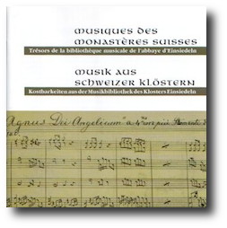

# CD - Musik aus Schweizer Klöstern

    

Die Idee, eine CD für RISM zu erstellen, stand bereits seit längerer
Zeit im Raum. Im Jahr 2009 wurde sie nun realisiert.

Mit Ausnahme des Magnificats von Anselm Schubiger -- eine Kontrafaktur
über Ausschnitte aus Mozarts Oper „Le nozze di Figaro" -- konnte auf
Aufnahmen zurückgegriffen werden, welche in der Eglise du Collège
Saint-Michel 2008 entstanden sind. Ausführende unter der Leitung von
Johannes Strobl sind das auf ältere Musik spezialisierte Orchester
Capriccio Basel, die Cappella Murensis sowie einige auf sakrale Musik
spezialisierte Solosängerinnen und -sänger.

Die CD enthält vornehmlich liturgische Werke aus dem 18. Jahrhundert.
Auf der einen Seite stehen zwei Kompositionen von Giovanni Battista
Sammartini (1701-1775): das Miserere und das Beatus vir; letzteres
ebenfalls eine Kontrafaktur. Es handelt sich um Werke, welche schon früh
den Weg nach Bellinzona ins Filialkloster und schliesslich über die
Alpen ins Mutterkloster nach Einsiedeln fanden. Auf der anderen Seite
zeugen zwei klostereigene Kompositionen vom regen Musikbetrieb in der
Einsiedler Benediktiner Abtei. Die beiden Werke von P. Gerold
Brandenberg (1729-1795) einerseits und von P. Marian Müller (1724-1780)
andererseits wurden eigens für das in Einsiedeln noch heute wichtige und
gern gefeierte Fest der Engelweihe komponiert. Den Abschluss bildet das
bereits erwähnte Magnificat von Schubiger, welches anlässlich des
Konzertes während der Internationalen Arbeitstagung der
RISM-Arbeitsstellen im Rahmen des IMS-Kongresses 2007 eingespielt wurde.

#### Zeitungsartikel


