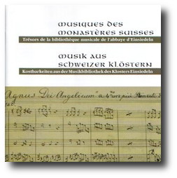

# CD - Swiss Monasteries Music

    

The production of a CD had been on the wishlist of the RISM for a while.
In 2009, it became possible to achieve this.

The CD is based on recordings produced at the Saint-Michel church, with
the exception of the Magnificat by Anselm Schubiger - a contrafacta on
excerpts of the Mozart opera \"Le nozze di Figaro\". It is performed by
an ensemble specialized in early music, Capriccio Basel, the vocal
ensemble Cappella Murensis, and solo singers specialized in sacred
music, under the direction of Johannes Strobl.

The CD contains mostly liturgical works from the 18th century, starting
with two compositions by Giovanni Battista Sammartini (1701-1775): the
Miserere and the Beatus vir, the second being a contrafacta. The
contrafacta is based on a work that very early on made its way to the
affiliated monastery of Bellinzona, and then through the Alps to the
principal monastery of Einsiedeln. The CD also includes two original
compositions from the internal production of the benedictine monastery
of Ensiedeln. The two works, one by P. Gerold Brandenberg (1729-1795)
and the other by P. Marian Müller (1724-1780), were specially composed
for the Engelweihe feast, which is still widely celebrated today. The
Magnificat by Schubiger mentioned earlier, played during a concert at
the international RISM days organised within the IMS congress in 2007,
concludes the CD.

#### Press articles


