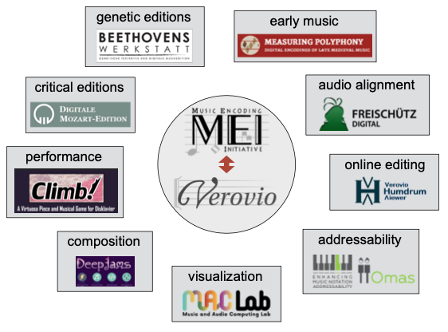

# Das Notenstichwerkzeug Verovio

[Verovio](https://www.verovio.org/index.xhtml) ist für ein breites Anwendungsspektrum konzipiert und wurde von mehreren Projekten oder Institutionen übernommen. Es funktioniert auf Desktop-Computern, aber auch auf Tablets und mobilen Geräten. Verovio wurde zum Rendern von MEI-Dateien erstellt, bietet aber auch grundlegende Unterstützung für andere Musiknotationsformate, wie z.B. MusicXML-Import und MIDI-Ausgabe. 

Obwohl es zunächst nur als Bestandteil von Muscat zur Visualisierung von Musikincipits begann, gewann es im Laufe der Jahre zunehmend an Bedeutung und wird nun als vollwertiges Open-Source-Projekt entwickelt. Die Entwicklung dieses einzigartigen Notenstichwerkzeugs erfolgt in enger Zusammenarbeit mit der MEI-Gemeinschaft. Bis zu einem gewissen Grad dient es als Referenzimplementierung für die wichtigsten Kernmerkmale des MEI-Schemas. 

Verovio ist eine Software-Bibliothekskomponente, bei der es sich nicht um eine vollständige Software-Anwendung handelt, sondern nur um ein Software-Modul, das in vollständigen Anwendungen verwendet werden soll. Dieser modulare Ansatz entspricht den Gestaltungsmustern moderner Softwarearchitekturen und ist ein wichtiger Grund für die weite Verbreitung und den Erfolg von Verovio. 

Es wird heute in Dutzenden von Projekten in der digitalen Musikwissenschaft eingesetzt, wobei die Anwendungen von digitalen kritischen Ausgaben, genetischen Ausgaben, Alter Musik, Audio-Alignment, Online-Editing, Musik-Adressierbarkeit, Visualisierung, Aufführung und sogar Komposition mittels künstlicher Intelligenz reichen.

Erfahren Sie mehr über Verovio auf seiner [eigenen Website](https://www.verovio.org).
