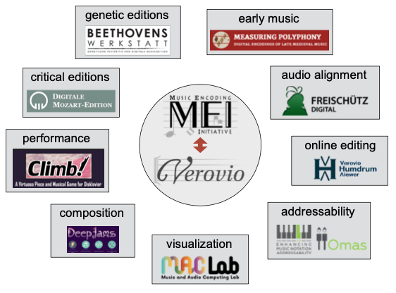

# The Verovio music engraving tool

[Verovio](https://www.verovio.org/index.xhtml) is designed to be used in a wide range of applications and has been adopted by several projects or institutions. It works on desktop computers but also tablets and mobile devices. Verovio is created to render MEI files but also provides basic support for other music notation formats, such as MusicXML import and MIDI output. 

Although it started simply as a component of Muscat for visualising music incipits, it became increasingly important over the years and is now being developed as a fully-fledged open-source project. The development of this unique music engraving tool is conducted in close collaboration with the MEI community. To some extent, it acts as a reference implementation for the most important core features of the MEI Schema. 

Verovio is a software library component that is not a full software application, but instead only a software module to be used in full software applications. This modular approach meets modern software architecture design patterns and is an important reason for the wide adoption and success of Verovio. 

It is now used in dozens of projects in digital musicology, with applications ranging from digital critical editions, genetic editions, audio alignment, online editing, visualisation, performance, to composition via artificial intelligence.

Learn more about Verovio on its [dedicated website](https://www.verovio.org).
