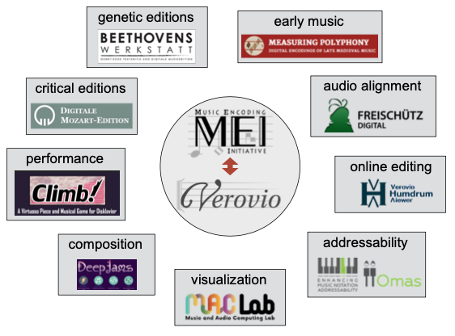

# L'outil de gravure musicale Verovio

[Verovio](https://www.verovio.org/index.xhtml) est conçu pour être utilisé dans un large éventail d'applications et a été adopté par plusieurs projets ou institutions. Il fonctionne sur les ordinateurs de bureau mais aussi sur les tablettes et les appareils mobiles. Verovio est créé pour rendre les fichiers MEI mais fournit également un support de base pour d'autres formats de notation musicale, tels que l'importation MusicXML et la sortie MIDI. 

Bien qu'il ait commencé simplement comme un composant de Muscat pour visualiser les incipits musicaux, il est devenu de plus en plus important au fil des années et est maintenant développé comme un projet open-source à part entière. Le développement de cet outil unique de gravure musicale est mené en étroite collaboration avec la communauté MEI. Dans une certaine mesure, il agit comme une mise en œuvre de référence pour les caractéristiques essentielles les plus importantes du schéma MEI. 

Verovio est un composant de bibliothèque de logiciels qui n'est pas un logiciel complet, mais plutôt un module logiciel à utiliser dans des applications complètes. Cette approche modulaire répond aux modèles de conception de l'architecture logicielle moderne et constitue une raison importante de l'adoption et du succès de Verovio. 

Il est maintenant utilisé dans des dizaines de projets en musicologie numérique, avec des applications allant des éditions critiques numériques, des éditions génétiques, de la musique ancienne, de l'alignement audio, de l'édition en ligne, de l'adressabilité de la musique, de la visualisation, de l'interprétation et même de la composition au moyen de l'intelligence artificielle.

Pour en savoir plus sur Verovio, consultez son [site web dédié](https://www.verovio.org).
