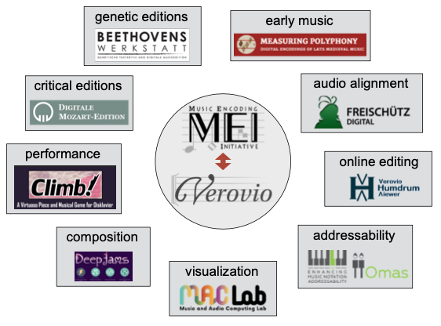

# Verovio, uno strumento per la notazione musicale

[Verovio](https://www.verovio.org/index.xhtml) è stato progettato per essere utilizzato in una vasta gamma di applicazioni ed è stato adottato da diversi progetti o istituzioni. Funziona su computer desktop ma anche su tablet e dispositivi mobili. Verovio è stato creato per rendere i file MEI ma fornisce anche un supporto di base per altri formati di notazione musicale, offrendo una importazione MusicXML e una uscita MIDI. 

Sebbene sia nato semplicemente come componente di Muscat per la visualizzazione di incipit musicali, nel corso degli anni è diventato sempre più importante ed è ora in fase di sviluppo come progetto open-source a pieno titolo. Lo sviluppo di questo strumento unico per l'incisione musicale è condotto in stretta collaborazione con la comunità MEI. In una certa misura, esso funge da implementazione di riferimento per le più importanti caratteristiche fondamentali dello Schema MEI. 

Verovio è un componente di libreria software che non è un'applicazione software completa, ma solo un modulo software da utilizzare in applicazioni complete. Questo approccio modulare soddisfa i moderni modelli di progettazione dell'architettura software ed è una ragione importante per l'ampia adozione e il successo di Verovio. 

È ora utilizzato in decine di progetti di musicologia digitale, con applicazioni che vanno dalle edizioni critiche digitali, alle edizioni genetiche, all'allineamento audio, all'editing online, alla visualizzazione, all'esecuzione musicale fino alla composizione attraverso l'intelligenza artificiale.

Per saperne di più su Verovio, visitate il suo [sito web dedicato](https://www.verovio.org).
